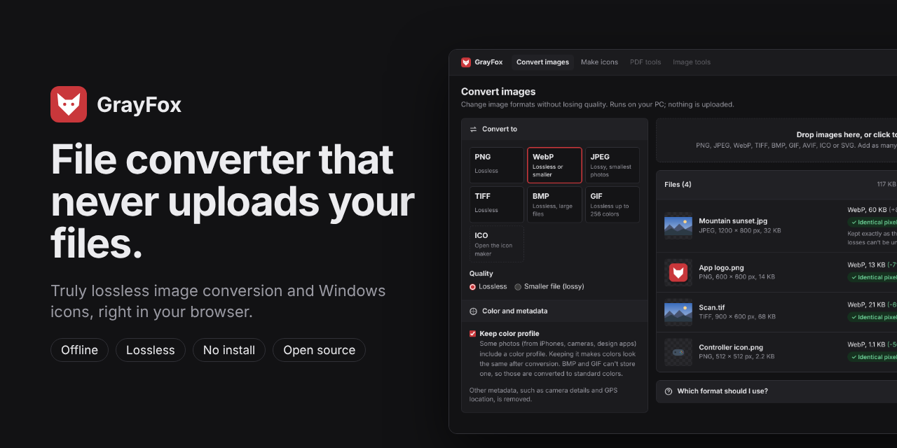
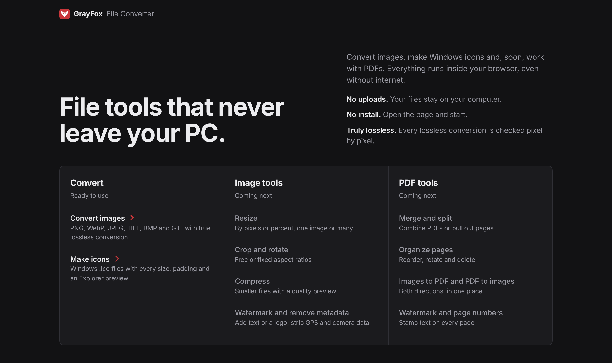
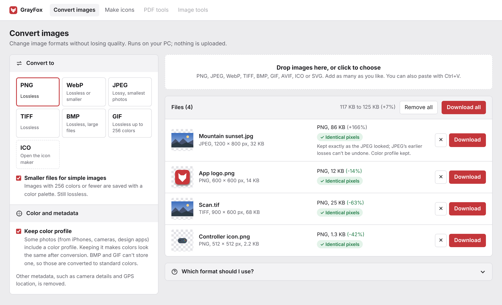
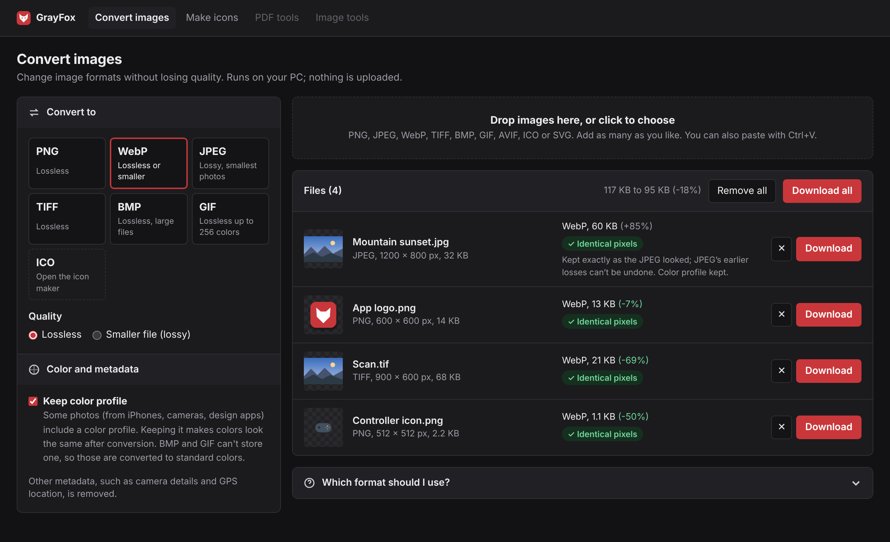
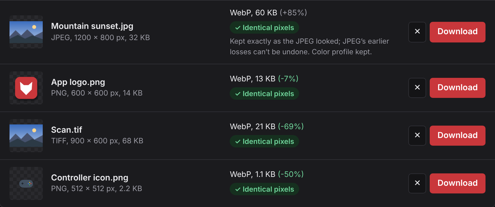
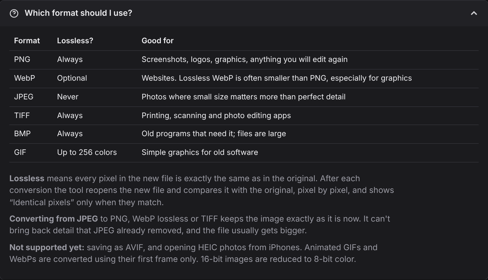
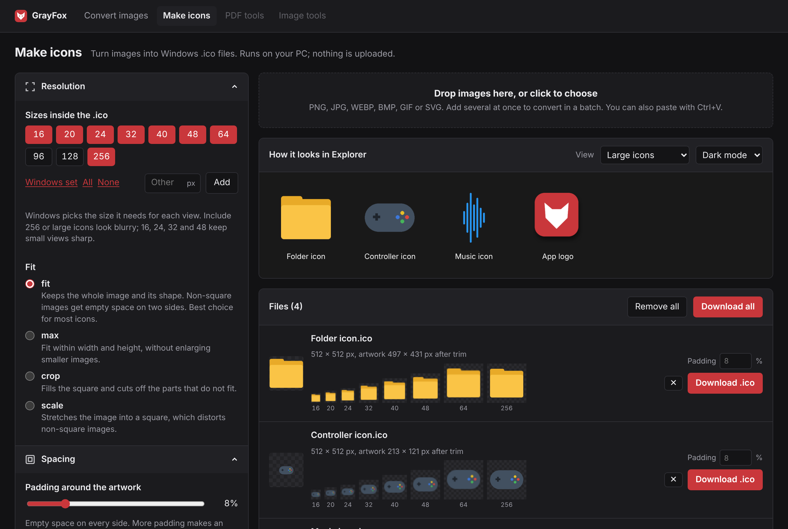
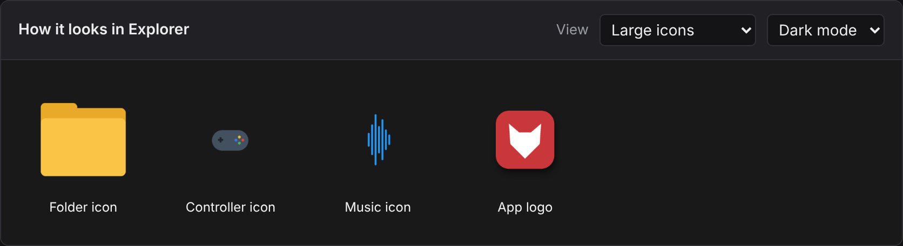
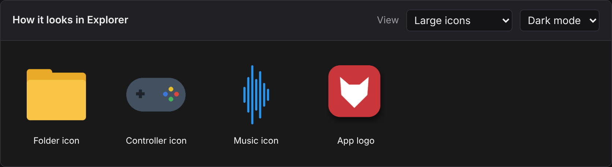

<div align="center">



# GrayFox – File Converter

**Convert images and make Windows icons, entirely on your own computer.**<br>
Truly lossless conversion, verified pixel by pixel. No uploads, no install, no account.

[](LICENSE)


[**Open GrayFox online**](https://Haroon-EL.github.io/grayfox-file-converter/) · [Download for offline use](#getting-started) · [Report a problem](../../issues)

</div>

---

## Contents

- [What is GrayFox?](#what-is-grayfox)
- [Features](#features)
- [Getting started](#getting-started)
- [Convert images](#convert-images)
- [Make Windows icons](#make-windows-icons)
- [Supported formats](#supported-formats)
- [How lossless conversion works](#how-lossless-conversion-works)
- [Privacy](#privacy)
- [Browser support](#browser-support)
- [Known limitations](#known-limitations)
- [Roadmap](#roadmap)
- [FAQ](#faq)
- [Project structure](#project-structure)
- [Contributing](#contributing)
- [License](#license)

---

## What is GrayFox?

GrayFox is a set of file tools that run inside your web browser, with no server behind them. Your files are read and converted on your own computer and saved straight to your Downloads folder. Nothing is uploaded, so it works without an internet connection and is safe for private photos, work documents and anything else you don't want to send to a website.

It's built for two everyday jobs today, with more on the way:

| Tool | What it does | Status |
|---|---|---|
| **Convert images** | Change between PNG, WebP, JPEG, TIFF, BMP and GIF, with true lossless conversion | ✅ Ready |
| **Make icons** | Turn images into Windows `.ico` files with every size, padding and an Explorer preview | ✅ Ready |
| **Image tools** | Resize, crop, compress, watermark, remove metadata | 🛠 Planned |
| **PDF tools** | Merge, split, organize pages, images to PDF and back | 🛠 Planned |



## Features

- 🔒 **Private.** Files never leave your computer. There is no server, no tracking and no account.
- ✈️ **Works offline.** Download once and use it anywhere, even with no internet.
- 🎯 **Truly lossless.** PNG, WebP, TIFF, BMP and GIF conversions keep every pixel exactly, including semi-transparent ones.
- ✅ **Verified results.** Every lossless conversion is reopened and compared with the original, pixel by pixel.
- 🎨 **Color profiles kept.** Photos from phones, cameras and design apps keep their colors.
- 📦 **Batch conversion.** Convert dozens of files at once and download them as one ZIP.
- 🪟 **Windows icons done right.** Multi-size `.ico` files that look sharp and evenly sized in Explorer.
- 🌗 **Light and dark mode.** Follows your Windows setting automatically.
- 🧩 **Zero dependencies.** Each tool is a single HTML file with no external libraries.

<details>
<summary>See light mode</summary>



</details>

## Getting started

### Option 1: use it online

Open **https://YOUR-USERNAME.github.io/grayfox-file-converter/** in Edge or Chrome. The online version still runs entirely in your browser; your files are not uploaded.

### Option 2: download for offline use

1. Click the green **Code** button at the top of this page, then **Download ZIP**.
2. Unzip the folder anywhere, for example `Documents\GrayFox`.
3. Double-click **`index.html`**. It opens in your browser and works without internet.

> **Tip:** keep all the files together in one folder. Each tool also works on its own, so you can open `convert.html` or `ico.html` directly.

## Convert images



1. Open **Convert images**.
2. Choose a format under **Convert to**.
3. Drop your images onto the page, click to choose them, or paste one with **Ctrl+V**.
4. Check the badge next to each file, then click **Download** or **Download all**.

Changing the format or an option reconverts all files instantly, so you can compare sizes before downloading.

### What the badges mean



| Badge | Meaning |
|---|---|
| **✓ Identical pixels** | The new file was reopened and every pixel matches the original exactly. |
| **Lossy** | You chose a lossy format or setting (JPEG, WebP "Smaller file", or GIF for images with more than 256 colors). Some detail is removed to make the file smaller. |
| **N pixels differ** | A lossless conversion did not match. This should never happen; please [report it](../../issues). |
| **Can't open** | The file isn't a supported format or is damaged. The message explains what to do. |

### Options

| Format | Options |
|---|---|
| PNG | **Smaller files for simple images:** uses a color palette when an image has 256 colors or fewer. Still lossless. |
| WebP | **Lossless**, or **Smaller file (lossy)** with a quality slider. |
| JPEG | Quality slider, and a background color for transparent areas. |
| TIFF | **LZW** compression (smaller) or **None**. Both are lossless. |
| BMP | Saved as 24-bit, or 32-bit when the image has transparency. |
| GIF | Lossless for images within GIF's limits; colors are reduced otherwise. |

**Keep color profile** (on by default) embeds the original color profile in PNG, WebP, TIFF and JPEG files, so colors look the same after conversion. BMP and GIF can't store a profile, so their colors are converted to standard sRGB instead.

### Which format should I use?



- **PNG:** screenshots, logos, graphics, and anything you'll edit again.
- **WebP:** websites. Lossless WebP is often much smaller than PNG for graphics (the icon in the screenshot above shrank by 50%).
- **JPEG:** photos where a small file matters more than perfect detail.
- **TIFF:** printing, scanning and photo editing apps.
- **BMP and GIF:** older programs that require them.

## Make Windows icons



1. Open **Make icons** and drop in one or more images.
2. Pick the sizes to include. The **Windows set** (16, 20, 24, 32, 40, 48, 64 and 256 px) covers every Explorer view and display scaling level.
3. Choose how the image fits the square: **fit**, **max**, **crop** (with a choice of which part to keep) or **scale**.
4. Adjust **padding** and **Trim transparent edges** while watching the Explorer preview.
5. Download each `.ico`, or all of them as a ZIP.

### Make a set of icons look the same size

Windows draws every icon in the same square. An image that fills its square edge to edge looks big; one with lots of empty space around it looks small. **Trim transparent edges** removes that built-in empty space, and **padding** then adds the same margin to every icon.

| Without trimming | With trimming and equal padding |
|---|---|
|  |  |

If one icon still looks off (a wide shape looks shorter than a square one), give that file its own padding value.

### Using your icons

- **Set a folder icon:** keep the `.ico` in a permanent place first (inside the folder works well), then right-click the folder and choose **Properties > Customize > Change Icon**.
- **Icon not updating?** Windows caches icons. Press **Win+R** and run `ie4uinit.exe -show`, or restart Windows Explorer from Task Manager.

## Supported formats

| Format | Open | Save | Lossless when saving | Color profile |
|---|:---:|:---:|---|:---:|
| PNG | ✅ | ✅ | Always | ✅ |
| WebP | ✅ | ✅ | In lossless mode | ✅ |
| JPEG | ✅ | ✅ | Never (JPEG is always lossy) | ✅ |
| TIFF | ✅ ¹ | ✅ | Always | ✅ |
| BMP | ✅ | ✅ | Always | – |
| GIF | ✅ ² | ✅ | Up to 256 colors, no partial transparency | – |
| ICO | ✅ | ✅ ³ | Always | – |
| AVIF | ✅ | – | – | – |
| SVG | ✅ ⁴ | – | – | – |
| HEIC | – | – | – | – |

¹ 8-bit TIFFs with no compression, LZW, Deflate or PackBits, stored in strips. Tiled and CMYK TIFFs aren't supported yet.<br>
² Animated GIFs use their first frame.<br>
³ Through the icon maker.<br>
⁴ SVGs are drawn as pixels at up to 1024 px.

## How lossless conversion works

"Lossless" should mean every pixel in the new file is exactly the same as in the original. Many converters fall short of that, even when they say "lossless".

**The problem.** Browsers store images internally with *premultiplied alpha*: each color value is multiplied by its transparency. When a page reads pixels back out or saves an image through the standard canvas functions, semi-transparent pixels get rounded. In testing, the standard method changed **75% of the pixels** in an image with soft transparency.

**GrayFox avoids this in three ways:**

1. **Exact reading.** Images are decoded with premultiplication and color conversion turned off, and their pixels are read through WebGL, which returns them untouched.
2. **Its own encoders.** PNG, WebP lossless (VP8L), TIFF (LZW), BMP and GIF files are written by GrayFox's own code instead of the browser's canvas functions. The PNG encoder uses the browser's built-in compression.
3. **Verification.** After saving, GrayFox reopens the new file and compares it with the original, pixel by pixel, before showing "Identical pixels". Fully transparent pixels count as equal regardless of their hidden color values, since they look identical.

The encoders were tested on photos, graphics with soft transparency, palette images and several TIFF variants. Every lossless output matched exactly, both in the browser and when opened with independent decoders (libpng, libwebp and libtiff), so the files work in other apps too.

**Converting from JPEG** to a lossless format keeps the image exactly as the JPEG looks now. It can't restore detail that JPEG compression already removed, and the file usually gets bigger.

## Privacy

- There is no server. The pages are plain files that run in your browser.
- Files are read from your disk, processed in memory, and saved to your Downloads folder.
- No analytics, cookies, trackers or network requests of any kind.
- Converted files contain no camera details, GPS location or other metadata, only the color profile when **Keep color profile** is on.

You can check this yourself: open the page, turn off your internet connection, and everything still works.

## Browser support

| Browser | Status |
|---|---|
| Microsoft Edge | ✅ Recommended |
| Google Chrome | ✅ Recommended |
| Firefox | Works; WebP lossy and AVIF depend on the version |
| Safari | Not tested |

GrayFox uses standard web features (WebGL, `CompressionStream`, `createImageBitmap`) available in current versions of Edge and Chrome.

## Known limitations

- Saving as AVIF and opening HEIC photos from iPhones aren't supported yet.
- Animated GIF and WebP files are converted using their first frame.
- 16-bit images are reduced to 8-bit color.
- WebP lossless files are much smaller than PNG for graphics, but about the same size as PNG for photos.
- ICO files hold images up to 256 × 256, which is the largest size Windows displays.
- Very large images (above roughly 8,000 × 8,000 pixels) may be slow or run out of memory.

## Roadmap

- [x] Image converter with verified lossless conversion
- [x] Windows icon maker
- [ ] Image tools: resize, crop, rotate, compress, watermark, remove metadata
- [ ] PDF tools: merge, split, organize pages, images to PDF, PDF to images, watermark, page numbers
- [ ] Installable app version (works offline after one visit, adds AVIF and HEIC)

## FAQ

**Is it really free?**<br>
Yes. GrayFox is open source under the MIT license.

**Why does my file get bigger after converting?**<br>
Lossless formats store every pixel exactly. A JPEG photo converted to PNG or lossless WebP is usually larger, because JPEG had already thrown detail away to save space. Use WebP "Smaller file" or JPEG if size matters more than exact pixels.

**Can it convert ICO files back to PNG?**<br>
Yes. Drop the `.ico` into **Convert images**; it uses the largest image inside the icon.

**Why can't I save as 512 × 512 ICO?**<br>
The ICO format stores each image's size in a single byte, so 256 × 256 is the maximum, and Windows never displays anything larger.

**My converted image looks different from the original.**<br>
Make sure **Keep color profile** is on. If it still looks different and the badge says "Identical pixels", the difference comes from how the viewing app handles color profiles, not from the conversion.

## Project structure

```
grayfox-file-converter/
├── index.html          Home page
├── convert.html        Image converter
├── ico.html            Icon maker
├── docs/
│   ├── social-preview.png
│   └── screenshots/    Images used in this README
├── CHANGELOG.md
├── LICENSE
└── README.md
```

Each tool is a single self-contained HTML file: markup, styles and scripts together, with no build step and no external libraries. To change something, edit the file and reload the page.

## Contributing

Bug reports and ideas are welcome. Please [open an issue](../../issues) and include:

- what you did and what you expected,
- your browser and its version,
- the file that caused the problem, if you can share it.

Pull requests are welcome too. Keep each tool self-contained, avoid adding external libraries, and test lossless changes by checking that the "Identical pixels" badge still appears.

## License

[MIT](LICENSE). Free to use, modify and share.
